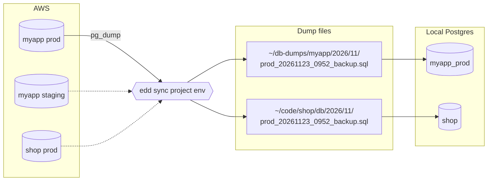
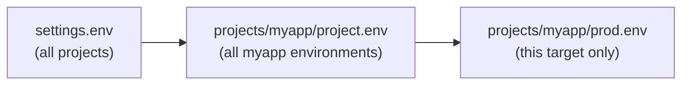

# easy-db-dump (`edd`)

Bring Postgres databases from AWS/RDS into your local Postgres with **one click** — for as many
projects and environments as you work on, from a **single installation**. Works on **Linux and macOS**.

You install it **once per machine** and configure each project/environment **once**. After that,
every refresh is a click on the "DB sync" launcher (pick the target from a menu), or zero clicks
with the daily timer.



Assumption: the remote databases are publicly accessible, so no VPN, bastion or tunnel is needed.

---

## Concepts

- **Project**: an application you work on (`myapp`, `shop`…).
- **Environment**: one of its remote databases (`prod`, `staging`…).
- **Target** = project + environment, written `myapp prod` or `myapp:prod`. Every command works on a target.

You clone this repo **once**, no matter how many projects you have. Projects are just config files.

## Where things live

Code, config and dumps are kept apart:

| What | Where | Notes |
|---|---|---|
| **The script** | this repo, e.g. `~/code/utils/easy-db-dump/bin/edd` | cloned once; `git pull` to update |
| **The command** | `~/.local/bin/edd` | symlink to the script, created by `bin/install` |
| **Config** | `~/.edd/` | one folder per project, one file per environment |
| **Dumps** | `~/db-dumps/<project>/YYYY/MM/` | root configurable; a project can use its own folder |
| **Launcher** | Linux: `~/.local/share/applications/edd-sync.desktop`<br/>macOS: `~/Applications/DB sync.app` | created by `bin/install` |
| **Daily timer** | Linux: `~/.config/systemd/user/edd-sync@.{service,timer}`<br/>macOS: `~/Library/LaunchAgents/dev.easy-db-dump.sync.<project>.<env>.plist` | per target, created by `edd timer on` |

```
~/code/utils/easy-db-dump/              <- this repo (code only, no config, no dumps)
├── bin/edd                             <- the script
├── bin/edd-launch                      <- what the "DB sync" launcher runs
├── bin/install
├── templates/                          <- copied by `edd init`
└── systemd/

~/.edd/                                 <- all your config, outside any repo
├── settings.env                        <- global: BACKUP_DIR, RETENTION_DAYS, local Postgres defaults
└── projects/
    ├── myapp/
    │   ├── project.env                 <- shared by myapp's environments (optional)
    │   ├── prod.env                    <- target myapp:prod
    │   └── staging.env                 <- target myapp:staging
    └── shop/
        ├── project.env                 <- e.g. PROJECT_BACKUP_DIR=~/code/shop/db
        └── prod.env                    <- target shop:prod

~/db-dumps/                             <- BACKUP_DIR (default)
└── myapp/
    └── 2026/
        └── 11/
            ├── prod_20261123_0952_backup.sql
            └── staging_20261123_0955_backup.sql

~/code/shop/db/                         <- shop's PROJECT_BACKUP_DIR
└── 2026/11/prod_20261123_0952_backup.sql
```

To keep the config somewhere else, export `EDD_CONFIG_DIR` in your shell profile
(e.g. `export EDD_CONFIG_DIR="$HOME/Dropbox/edd"`) before running `bin/install`.

**The repo folder is the installation**: don't move or delete it (if you move it, run
`bin/install` again from the new location).

### Config layers

Each target is configured by three files, read in order. A later file overrides an earlier one,
so shared values are written once:



Typical split:

| File | Typical contents |
|---|---|
| `settings.env` | `BACKUP_DIR`, `RETENTION_DAYS`, and your usual local Postgres (`LOCAL_HOST`, `LOCAL_PORT`, `LOCAL_USER`, `LOCAL_PASSWORD`) |
| `project.env` | what differs for this project: its own local port (docker compose), `PROJECT_BACKUP_DIR`, excluded tables |
| `<env>.env` | the remote connection (`REMOTE_*`), password, and `LOCAL_DB` |

---

## One-time setup

### Once per machine

**0. Install the Postgres client** (`psql` and `pg_dump`), same major version as RDS or newer:

| | |
|---|---|
| Ubuntu/Debian | `sudo apt install postgresql-client` (or the [PGDG repo](https://www.postgresql.org/download/linux/) for newer versions) |
| macOS | `brew install libpq` and add it to your PATH: `echo 'export PATH="$(brew --prefix libpq)/bin:$PATH"' >> ~/.zshrc` |

Alternatively, skip this and set `PG_DOCKER_IMAGE=postgres:16` in `~/.edd/settings.env` to use the
binaries from Docker.

**1. Clone the repo** into a permanent folder:

```bash
git clone git@github.com:poacosta/easy-db-dump.git ~/code/utils/easy-db-dump
```

**2. Install:**

```bash
~/code/utils/easy-db-dump/bin/install
```

This creates the `edd` command (in `~/.local/bin`; the installer tells you if that folder is
missing from your `PATH`), the `~/.edd/` folder with `settings.env`, and a single **"DB sync"** launcher:

- **Linux**: an entry in the applications menu (plus the systemd units for the optional daily sync).
- **macOS**: an app in `~/Applications/DB sync.app`. Open it from Spotlight (`⌘ Space` → "DB sync")
  or drag it to the Dock. The first time, macOS asks to let it control Terminal: click **OK**.

**3. Review the global settings** in `~/.edd/settings.env`: where dumps go (`BACKUP_DIR`,
default `~/db-dumps`) and your usual local Postgres credentials, so you don't repeat them per project.

### Once per target (project + environment)

**4. Create the target:**

```bash
edd init myapp prod
```

This creates `~/.edd/projects/myapp/prod.env` (and `project.env` the first time for that
project) and opens it in your editor. Fill in:

```bash
REMOTE_HOST=myapp.xxxxxxxx.us-east-1.rds.amazonaws.com
REMOTE_PORT=5432
REMOTE_USER=postgres
REMOTE_DB=myapp

# Local database to restore into — it is DROPPED and recreated on every sync.
# Defaults to REMOTE_DB; use distinct names to keep environments side by side.
LOCAL_DB=myapp_prod
```

**5. Store the remote password** — pick **one** option:

- **a) `~/.pgpass` — recommended.** The standard Postgres password file, one line per database:
  ```bash
  echo 'myapp.xxxxxxxx.us-east-1.rds.amazonaws.com:5432:myapp:postgres:THE_PASSWORD' >> ~/.pgpass
  chmod 600 ~/.pgpass   # required, Postgres ignores the file otherwise
  ```
  Format: `host:port:database:user:password`. All your projects share this one file.
- **b) A secret manager**, with a command that prints the password, in the target file:
  ```bash
  REMOTE_PASSWORD_CMD='aws secretsmanager get-secret-value --secret-id myapp/prod/db --query SecretString --output text | jq -r .password'
  ```
- **c) Plain text** in the target file: `REMOTE_PASSWORD=...` (the file is `chmod 600` and lives outside any repo).

**6. Verify:**

```bash
edd check myapp prod
```

```
[edd] Target:      myapp:prod
[edd] Config file: /home/you/.edd/projects/myapp/prod.env
[edd] Dump folder: /home/you/db-dumps/myapp
[edd] Remote OK: postgres@myapp.xxxxxxxx.us-east-1.rds.amazonaws.com:5432/myapp
[edd] Local OK:  postgres@localhost:5432 (target database: myapp_prod)
[edd] All good. 'edd sync myapp prod' is ready.
```

**7. (Optional) Daily automatic sync** for this target:

```bash
edd timer on myapp prod
```

It runs Monday to Friday at 08:30, then deletes old dumps. You get a desktop notification on
success and on failure.

| | Scheduler | If the machine was off or asleep at 08:30 | Logs |
|---|---|---|---|
| Linux | systemd user timer (random delay up to 10 min, so several targets don't dump at once) | runs on the next boot | `journalctl --user -u edd-sync@myapp:prod` |
| macOS | launchd agent | runs when the Mac wakes up (skipped if it was shut down) | `~/Library/Logs/easy-db-dump/myapp-prod.log` |

On macOS, `edd timer on` saves your current `PATH` into the agent so it finds `pg_dump` and
`docker`; if you change where they are installed, run `edd timer on` again.

Repeat steps 4–7 for each new project or environment. Steps 1–3 are never repeated.

---

## Daily use: one click

Open **"DB sync"** (applications menu on Linux, Spotlight or the Dock on macOS) and pick the target:

```
1) myapp:prod
2) myapp:staging
3) shop:prod
Select a target: 1
```

With a single configured target it starts right away; with [`fzf`](https://github.com/junegunn/fzf)
installed you get a searchable list instead (handy with 20 projects). A desktop notification tells
you when it's done.

From a terminal:

```bash
edd sync myapp prod      # or: edd sync myapp:prod, or just: edd sync (picker)
```

## All commands

| Command | What it does |
|---|---|
| `edd init <project> <env>` | create a target's config file and open it |
| `edd sync [target]` | dump + restore (what the launcher runs) |
| `edd check [target]` | verify remote and local connections |
| `edd dump [target]` | dump only |
| `edd restore [target] [file]` | recreate the local database and restore (defaults to the target's latest dump) |
| `edd targets` | list configured targets |
| `edd list [project]` | list dumps with their full path |
| `edd clean` | delete dumps older than `RETENTION_DAYS`, per project |
| `edd timer list` | show scheduled daily syncs |
| `edd timer on\|off <project> <env>` | enable/disable the daily sync of a target |

A target can be written `myapp prod` or `myapp:prod`. Omit it to get the picker.

## Settings reference

Any setting can go in any layer (`settings.env`, `project.env`, `<env>.env`).

| Setting | Default | Purpose |
|---|---|---|
| `REMOTE_HOST`, `REMOTE_PORT`, `REMOTE_USER`, `REMOTE_DB` | –, `5432`, `postgres`, – | remote database |
| `REMOTE_PASSWORD_CMD` / `REMOTE_PASSWORD` | empty | remote password, if not in `~/.pgpass` |
| `LOCAL_HOST`, `LOCAL_PORT`, `LOCAL_USER`, `LOCAL_PASSWORD` | `localhost`, `5432`, `postgres`, empty | local Postgres |
| `LOCAL_DB` | `REMOTE_DB` | local database (dropped and recreated on every restore) |
| `BACKUP_DIR` | `~/db-dumps` | dumps go to `<BACKUP_DIR>/<project>/YYYY/MM/` |
| `PROJECT_BACKUP_DIR` | empty | use this folder for the project instead (`YYYY/MM/` created inside) |
| `RETENTION_DAYS` | `30` | `edd clean` deletes older dumps |
| `PG_DOCKER_IMAGE` | empty | run `pg_dump`/`psql` from Docker, e.g. `postgres:16` (on macOS, `localhost` is mapped to `host.docker.internal` automatically) |
| `PG_DUMP_EXTRA_ARGS` | `--no-owner --no-privileges` | extra `pg_dump` flags, e.g. `--exclude-table-data=audit_logs` |
| `RESTORE_STRICT` | `0` | `1` = abort the restore on the first SQL error |
| `ALLOW_NON_LOCAL_RESTORE` | `0` | `1` = allow restoring into a non-localhost server |

## How it differs from running the commands by hand

- **Recreates the local database** before restoring (`DROP DATABASE … WITH (FORCE)` + `CREATE`), so there are no "already exists" errors or mixed data, even if your app has open connections.
- **`--no-owner --no-privileges`** on the dump avoids RDS role errors (`rdsadmin`, etc.) locally.
- **Atomic writes**: the dump is written as `.partial` and only renamed on success, so `restore` never picks up a truncated dump.
- **Safety guard**: refuses to restore if `LOCAL_HOST` is not `localhost` (unless `ALLOW_NON_LOCAL_RESTORE=1`).

## Troubleshooting

| Symptom | Fix |
|---|---|
| `Remote FAILED` / `pg_dump failed` | check `REMOTE_*` and the password; a `~/.pgpass` line must match host, port, db and user exactly, and the file must be `chmod 600` |
| connection times out | the RDS security group must allow inbound 5432 from your public IP |
| `server version mismatch` | your `pg_dump` is older than RDS: set `PG_DOCKER_IMAGE=postgres:<rds major>` |
| `Local FAILED` | start the project's local Postgres (e.g. `docker compose up -d db`) and check `LOCAL_*` |
| `... not found. Run: edd init ...` | the target has no config file yet, or a typo in the project/env name (`edd targets`) |
| `BACKUP_DIR expands to '/home/you/home/you/...'` | `~` and `$HOME` already mean your home folder: write `~/code/myapp/db`, not `~/home/you/code/myapp/db` |
| dumps land in `.../db/<project>/YYYY/MM/` but you want `.../db/YYYY/MM/` | use `PROJECT_BACKUP_DIR` (no project subfolder) instead of `BACKUP_DIR` |
| timer run failed | Linux: `journalctl --user -u edd-sync@myapp:prod` · macOS: `~/Library/Logs/easy-db-dump/myapp-prod.log` |
| macOS timer: `pg_dump not found` | the agent uses the `PATH` from when you ran `edd timer on`: fix your `PATH`, then run `edd timer on myapp prod` again |
| macOS: "DB sync" does nothing | allow it in System Settings → Privacy & Security → Automation → DB sync → Terminal |
| launcher missing (Linux) | log out and back in, or run `update-desktop-database ~/.local/share/applications` |
| `edd: command not found` | add `~/.local/bin` to your `PATH` (`~/.bashrc` on Linux, `~/.zshrc` on macOS) and open a new terminal |

## Requirements

- **Linux** (with systemd for the daily timer) or **macOS** (recent versions; works with the bash 3.2
  that ships with macOS, nothing else to install).
- `psql`/`pg_dump`, or Docker with `PG_DOCKER_IMAGE`.
- Optional: [`fzf`](https://github.com/junegunn/fzf) for a searchable picker (`brew install fzf` /
  `sudo apt install fzf`); `notify-send` for notifications on Linux (macOS uses its built-in notifications).

Windows is not supported natively; inside WSL2 it works as on Linux (without the launcher).

## Notes

- File names have minute precision (`HHMM`), so two dumps of the same target within the same minute overwrite each other.
