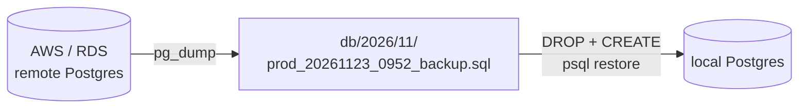

# easy-db-dump (`edd`)

Bring a Postgres database from AWS/RDS into your local Postgres with **one click**.

You configure it **once** (≈5 minutes). After that, every refresh is a single click on the
"DB sync" launcher — or zero clicks, if you enable the daily timer.



Assumption: the remote databases are publicly accessible, so no VPN, bastion or tunnel is needed.

---

## One-time setup

You only do this once per machine (steps 1–2) and once per environment (steps 3–6).

### 1. Clone the repo

```bash
git clone <repo> ~/code/utils/easy-db-dump
cd ~/code/utils/easy-db-dump
```

### 2. Install the command and the launcher

```bash
bin/install prod
```

This single command:

| Creates | Where | Purpose |
|---|---|---|
| `edd` command | `~/.local/bin/edd` (symlink) | run it from any terminal |
| `config/settings.env` | repo | global settings (defaults are fine) |
| `config/prod.env` | repo, git-ignored | connection settings for `prod` |
| "DB sync (prod)" launcher | `~/.local/share/applications/` | **the one click** |
| daily timer | `~/.config/systemd/user/` | optional zero-click refresh (see step 6) |

Use any environment name instead of `prod` (`staging`, `qa`…). Run `bin/install <env>` again for each one.

### 3. Fill in the connection settings

Edit `config/prod.env`:

```bash
# Remote database (AWS / RDS)
REMOTE_HOST=mydb.xxxxxxxx.us-east-1.rds.amazonaws.com
REMOTE_PORT=5432
REMOTE_USER=postgres
REMOTE_DB=dbname

# Local database (restore target — it is DROPPED and recreated on every sync)
LOCAL_HOST=localhost
LOCAL_PORT=5432
LOCAL_USER=postgres
LOCAL_PASSWORD=postgres
LOCAL_DB=dbname
```

### 4. Store the remote password (once)

This replaces typing it at the `-W` prompt every day. Pick **one** option:

**a) `~/.pgpass` — recommended.** The standard Postgres password file, read automatically by `pg_dump`/`psql`:

```bash
echo 'mydb.xxxxxxxx.us-east-1.rds.amazonaws.com:5432:dbname:postgres:THE_PASSWORD' >> ~/.pgpass
chmod 600 ~/.pgpass   # required, Postgres ignores the file otherwise
```

Format: `host:port:database:user:password`. Leave the password lines in `config/prod.env` commented out.

**b) A secret manager**, via a command that prints the password, in `config/prod.env`:

```bash
REMOTE_PASSWORD_CMD='aws secretsmanager get-secret-value --secret-id prod/db --query SecretString --output text | jq -r .password'
# or: REMOTE_PASSWORD_CMD='secret-tool lookup service easy-db-dump env prod'   (GNOME Keyring)
# or: REMOTE_PASSWORD_CMD='op read "op://Private/prod-db/password"'           (1Password)
```

**c) Plain text** in `config/prod.env` (`REMOTE_PASSWORD=...`). The file is git-ignored, but prefer a) or b).

### 5. Verify the configuration

```bash
edd check prod
```

```
[edd] Remote OK: postgres@mydb.xxxxxxxx.us-east-1.rds.amazonaws.com:5432/dbname
[edd] Local OK:  postgres@localhost:5432 (target database: dbname)
[edd] All good. 'edd sync prod' is ready.
```

If something fails, see [Troubleshooting](#troubleshooting). Once `check` passes, setup is done.

### 6. (Optional) Daily automatic refresh

`bin/install prod` already enabled a timer that runs `edd sync prod` **Monday to Friday at 08:30**
(if the machine was off, it runs on the next boot), then deletes dumps older than `RETENTION_DAYS`.

```bash
systemctl --user list-timers | grep edd          # next run
journalctl --user -u edd-sync@prod               # logs
systemctl --user disable --now edd-sync@prod.timer   # turn it off (one click only)
```

To change the schedule, edit `OnCalendar=` in `~/.config/systemd/user/edd-sync@.timer`
and run `systemctl --user daemon-reload`.

---

## Daily use: one click

Open the applications menu and click **"DB sync (prod)"**. A terminal shows the progress, you get a
desktop notification when it finishes, and your local `dbname` now holds a fresh copy of prod.

From a terminal, the equivalent is:

```bash
edd sync prod
```

## All commands

| Command | What it does |
|---|---|
| `edd sync <env>` | dump + restore (what the launcher runs) |
| `edd check <env>` | verify remote and local connections |
| `edd dump <env>` | dump only, to `db/YYYY/MM/<env>_YYYYMMDD_HHMM_backup.sql` |
| `edd restore <env> [file]` | recreate the local database and restore (defaults to the latest dump of `<env>`) |
| `edd list [env]` | list dumps |
| `edd clean` | delete dumps older than `RETENTION_DAYS` days |
| `edd envs` | list configured environments |

## Global settings (`config/settings.env`)

| Setting | Default | Purpose |
|---|---|---|
| `BACKUP_DIR` | `db` | where dumps are stored (relative to the repo or absolute) |
| `RETENTION_DAYS` | `30` | `edd clean` deletes older dumps |
| `PG_DOCKER_IMAGE` | empty | run `pg_dump`/`psql` from Docker, e.g. `postgres:16` |
| `PG_DUMP_EXTRA_ARGS` | `--no-owner --no-privileges` | extra `pg_dump` flags |
| `RESTORE_STRICT` | `0` | `1` = abort the restore on the first SQL error |

## How it differs from running the commands by hand

- **Recreates the local database** before restoring (`DROP DATABASE … WITH (FORCE)` + `CREATE`), so there are no "already exists" errors or mixed data, even if your app has open connections.
- **`--no-owner --no-privileges`** on the dump avoids RDS role errors (`rdsadmin`, etc.) locally.
- **Atomic writes**: the dump is written as `.partial` and only renamed on success, so `restore` never picks up a truncated dump.
- **Safety guard**: refuses to restore if `LOCAL_HOST` is not `localhost` (unless `ALLOW_NON_LOCAL_RESTORE=1`).

## Troubleshooting

| Symptom | Fix |
|---|---|
| `Remote FAILED` / `pg_dump failed` | check `REMOTE_HOST`, `REMOTE_PORT`, user and password; if using `~/.pgpass`, its line must match host, port, db and user exactly and the file must be `chmod 600` |
| connection times out | the RDS security group must allow inbound 5432 from your public IP |
| `server version mismatch` | your `pg_dump` is older than RDS: set `PG_DOCKER_IMAGE=postgres:<rds major>` in `config/settings.env` |
| `Local FAILED` | start your local Postgres (e.g. `docker compose up -d db`) and check `LOCAL_*` |
| launcher missing from the menu | log out and back in, or run `update-desktop-database ~/.local/share/applications` |
| `edd: command not found` | add `~/.local/bin` to your `PATH` |

## Requirements

`bash` and `psql`/`pg_dump` (or Docker with `PG_DOCKER_IMAGE`).

## Notes

- File names have minute precision (`HHMM`), so two dumps of the same environment within the same minute overwrite each other.
